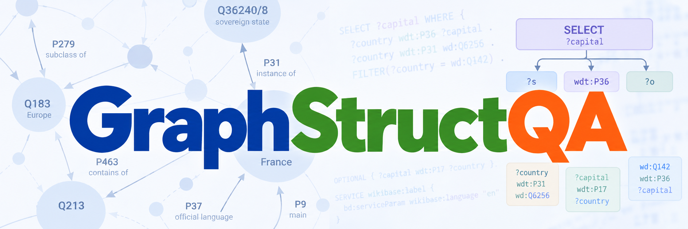

  

GraphStructQA is a research resource for studying large language model (LLM) answer reliability in relation to Wikidata knowledge graph structure and SPARQL query characteristics. The resource contains 14,729 natural-language questions paired with SPARQL queries, reference answers, structural and query features, responses from five LLMs, and answer-correctness judgments from two LLM evaluators.

## Repository contents

| Directory | Contents |
|---|---|
| [Dataset](https://github.com/ushtaralif/WikiStructQA/tree/main/data) | Dataset files, annotations, features, and analysis outputs. See the [data README](data/README.md). |
| [Source Code](src/) | Scripts for feature extraction, answer generation, evaluation, and analysis. See the [source README](src/README.md). |
| [Documentation](doc/) | Various documentation and background details about the resource.  |

## Query and Structural Features

A central component of GraphStructQA is its extracted query and knowledge graph structural features. These enable analysis of how query complexity and the characteristics of associated entities and properties relate to LLM answer accuracy.

See [Feature descriptions](doc/features.md) for definitions and computation details.

## Currently Evaluated LLMs

The resource currently includes responses from five LLMs:

- GPT-OSS-120B (`openai/gpt-oss-120b`)
- Llama 3.1 8B Instruct (`meta-llama/Llama-3.1-8B-Instruct`)
- Llama 3.3 70B Instruct (`meta-llama/Llama-3.3-70B-Instruct`)
- Mistral 7B Instruct v0.3 (`mistralai/Mistral-7B-Instruct-v0.3`)
- Phi-4 (`microsoft/phi-4`)

Responses have been independently assessed by two LLM evaluators: **GPT-5.4-mini** and **Claude Haiku 5.5**. Both use the same seven-category evaluation rubric, with categories 1–3 treated as correct. Prompts can be obtained from the source code.

## License and attribution

Unless otherwise indicated, original contributions to GraphStructQA,
including source code, documentation, and original dataset contributions
to the extent that rights subsist, are licensed under the
[Apache License 2.0](LICENSE).

Third-party material retains its applicable upstream terms:

- **Wikidata Query Logs (WDQL):** Apache License 2.0.
- **WikiWebQuestions (WWQ), including material derived from
  WebQuestions:** Creative Commons Attribution 4.0 International
  ([CC BY 4.0](LICENSES/CC-BY-4.0.txt)).
- **Wikidata structured data:** CC0 1.0.

The Apache licence for our contributions does not replace the applicable
licences of incorporated third-party material. Files containing material
from multiple sources remain subject to the relevant terms for each part.

See [Third-party notices](THIRD_PARTY_NOTICES.md) for source references
and a description of our modifications.

When using this resource in research, please cite GraphStructQA and
the relevant source datasets.