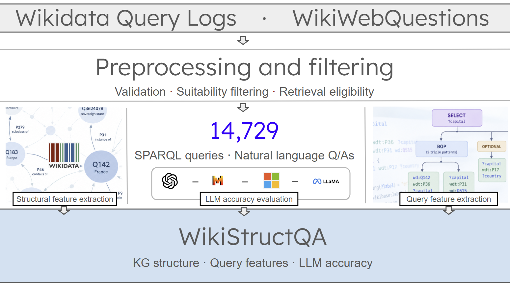

# WikiStructQA

WikiStructQA is a research resource for studying large language model (LLM) answer reliability in relation to Wikidata knowledge graph structure and SPARQL query characteristics.

The resource contains 14,729 natural-language questions paired with SPARQL queries, reference answers, structural and query features, responses from five LLMs, and answer-correctness judgments from two LLM evaluators.

  

## Repository contents

| Directory | Contents |
|---|---|
| [`data/`](data/README.md) | Dataset files, annotations, features, and analysis outputs. See the [data README](data/README.md). |
| [`src/`](src/README.md) | Scripts for feature extraction, answer generation, evaluation, and analysis. See the [source README](src/README.md). |
| [`figures/`](figures/) | Figures generated for analysis etc. |

### License and attribution

WikiStructQA is derived in part from the Wikidata Query Logs (WDQL) dataset and WikiWebQuestions (WWQ).

Original contributions to WikiStructQA are made available under the Creative Commons Attribution 4.0 International (CC BY 4.0) license, subject to any applicable rights and licensing conditions of the source datasets.

- **WDQL:** Sebastian Walter and Hannah Bast, *The Wikidata Query Logs Dataset* (2026). https://github.com/ad-freiburg/wikidata-query-logs
- **WWQ:** Silei Xu et al., *Fine-tuned LLMs Know More, Hallucinate Less with Few-Shot Sequence-to-Sequence Semantic Parsing over Wikidata* (2023). https://github.com/stanford-oval/wikidata-emnlp23
- **Wikidata:** https://www.wikidata.org — CC0 1.0.

Users should acknowledge the original datasets as well as WikiStructQA when redistributing or building upon this resource.

