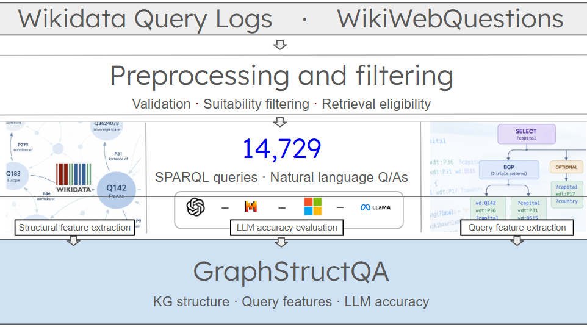

# GraphStructQA

  

GraphStructQA is a research resource for studying large language model (LLM) answer reliability in relation to Wikidata knowledge graph structure and SPARQL query characteristics. The resource contains 14,729 natural-language questions paired with SPARQL queries, reference answers, structural and query features, responses from five LLMs, and answer-correctness judgments from two LLM evaluators.

## Repository contents

| Directory | Contents |
|---|---|
| [Dataset](https://github.com/ushtaralif/WikiStructQA/tree/main/data) | Dataset files, annotations, features, and analysis outputs. See the [data README](data/README.md). |
| [Source Code](src/) | Scripts for feature extraction, answer generation, evaluation, and analysis. See the [source README](src/README.md). |
| [`doc/`](figures/) | Various documentation and background details about the resource.  |

## Query and Structural Features

A central component of GraphStructQA is its set of 35 query and knowledge graph structural features. These enable analysis of how query complexity and the characteristics of associated entities and properties relate to LLM answer accuracy.

See [Feature descriptions](doc/features.md) for definitions and computation details.

## Currently Evaluated LLMs

The resource currently includes responses from five LLMs:

- GPT-OSS-120B (`openai/gpt-oss-120b`)
- Llama 3.1 8B Instruct (`meta-llama/Llama-3.1-8B-Instruct`)
- Llama 3.3 70B Instruct (`meta-llama/Llama-3.3-70B-Instruct`)
- Mistral 7B Instruct v0.3 (`mistralai/Mistral-7B-Instruct-v0.3`)
- Phi-4 (`microsoft/phi-4`)

Responses have been independently assessed by two LLM evaluators: **GPT-5.4-mini** and **Claude Haiku 5.5**. Both use the same seven-category evaluation rubric, with categories 1–3 treated as correct. Prompts can be obtained from the source code.

### License and attribution

GraphStructQA is derived in part from the Wikidata Query Logs (WDQL) dataset and WikiWebQuestions (WWQ).

Original contributions to WikiStructQA are made available under the Creative Commons Attribution 4.0 International (CC BY 4.0) license, subject to any applicable rights and licensing conditions of the source datasets.

- **WDQL:** Sebastian Walter and Hannah Bast, *The Wikidata Query Logs Dataset* (2026). https://github.com/ad-freiburg/wikidata-query-logs
- **WWQ:** Silei Xu et al., *Fine-tuned LLMs Know More, Hallucinate Less with Few-Shot Sequence-to-Sequence Semantic Parsing over Wikidata* (2023). https://github.com/stanford-oval/wikidata-emnlp23
- **Wikidata:** https://www.wikidata.org — CC0 1.0.

Users should acknowledge the original datasets as well as WikiStructQA when redistributing or building upon this resource.

